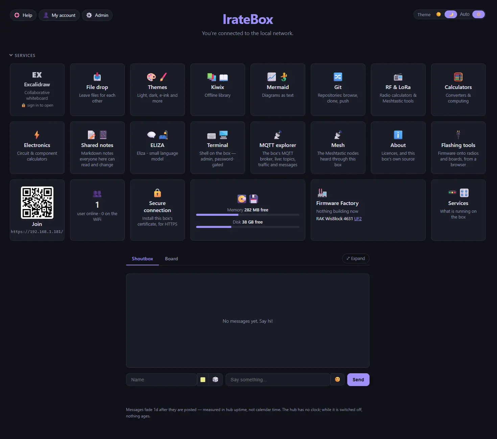

<!-- SPDX-License-Identifier: CC-BY-SA-4.0 -->
<!-- SPDX-FileCopyrightText: 2026 NomDeTom -->

# Irate-Box

A self-contained offline hub for a small board. Spiritually a [PirateBox](https://github.com/PirateBox-Dev) successor (hence the name), but Pi-first, offline-first, and built from maintained, packaged components rather than a 2013 shell-script. It runs a WiFi access point; anything that joins gets a captive portal that opens a landing page (the Hub), with an anonymous shoutbox and forum and filedrop just like the original.



That's about as far as the similarities go: the Hub has tiles for the other hosted applications you can reach, such as a whiteboard, a diagram editor, an offline encyclopaedia (courtesy of Kiwix), a small GIT repository, a series of calculators and many many more - all with no internet required at any point.

It is not a [FreedomBox](https://freedombox.org). A FreedomBox is a personal server for a household: named accounts, apps, and the owner's data behind them. Irate-Box is the other shape: an anonymous, offline-first hub for whoever joins its hotspot, keeping its data and identity on the box. It borrows FreedomBox's first-use code (a code only the installer prints) and its app model, but not its household-server assumptions.

**Status: installs and runs on a real board, hosts a real hotspot** `install.sh` puts the whole hub on an Armbian or mPWRD-OS board in one command. It has been tested end to end on a Luckfox Lyra Zero W (mPWRD-OS 26.05, armv7l, 512 MB), and a Raspberry Pi 3b+ (Raspberry Pi OS 64-bit). With everything running, the Lyra still has about 320 MB of memory free. The hub is served on whatever network the board is already on: the access point, dnsmasq and the captive portal are working, although not without some help since Android doesn't support HTTP captive portals. HTTPS with its own certificate authority, accounts and the hotspot firewall are built too. Every push to `main` builds the `.deb`; no release is tagged and there is no apt repository yet.

Target hardware is a Raspberry Pi Zero W or a similar 512 MB board, and that drives every design decision: static assets plus a handful of small native daemons.

Target use-case is the similar to the PirateBox: anonymous, pop-up services without internet, but also going beyond that to battery-powered SBCs that self-update when internet *is* available so that it is ready for when it *isn't* available.

## LLM usage

This is made with heavy assistance of an LLM, but I (a human being) do check it over and make sure it is doing what it says.

## Install on a board

On Armbian, or mPWRD-OS, which is an Armbian build:

```sh
git clone https://github.com/NomDeTom/irate-box && cd irate-box
sudo ./install.sh --with-notes --with-sync --with-mqtt --zim wikipedia_en_top_mini.zim
```

The script sets up nginx on `:80` (`--web caddy` for Caddy, the fallback) and the hub on loopback. The code goes in `/opt/irate-box`, state in `/var/lib/hub` and config in `/etc/hub`. No password is made: until the owner makes the admin account, anyone on the network can use `/admin/`, so make it straight after installing, over HTTPS (`/admin/setup`), or at the console over SSH (`sudo /opt/irate-box/irate-box hub_control set-admin NAME`); over plain HTTP the page lets you only by choice. Scripts get a login of their own only when asked for (`hub_control script-login`, or `--admin-password`). Running it again upgrades in place. `--apps-from-actions` fetches the Excalidraw, Mermaid and serial-terminal builds from the forks' Actions artifacts; `--apps DIR` takes your own desktop builds. Nothing is compiled on the board. **[docs/dev/building.md](docs/dev/building.md)** §4b lists every option.

Or as a Debian package: every push to `main` builds `irate-box_<version>_all.deb` (the CI run's artifact; a `v…` tag puts it on that release), or build one with `packaging/deb/build.sh`. `sudo apt install ./irate-box_*.deb` brings in what the installer needs; then `sudo irate-box-setup` (with any of the options above) sets the box up from the packaged code. The package does not set the box up by itself, since the installer asks apt for packages and downloads release files. After installing a newer package, `sudo irate-box-setup` with no options applies it with the box's own options.

**With no internet on the box**, an offline kit carries everything irate-box itself downloads: `./install.sh --make-offline-bundle DIR [--arch aarch64,armv7l] [--apps DIR] [--zim FILE]`, run on any machine with internet (no root), makes DIR hold the code, the apps, ttyd and SilverBullet for each architecture, any books, checksums and `setup.sh`. Copy it to the box and run `sudo ./setup.sh [options]` in it. A box already set up makes the same kit of itself from `/admin` → Backup → "Set up another box", offline too: its code, its apps, the release files it keeps (or its installed ttyd and SilverBullet), and its books if you like, as one download. Debian's own packages still come from the box's apt or its OS image.

## Try it without a board

Needs only Python 3.

```sh
git clone <this repo> irate-box && cd irate-box
./irate-box server
```

Open <http://localhost:8000>. That gives you the landing page, the **shoutbox** and the **board** — the parts that need nothing else. The service tiles link to paths that only exist behind the web server, so they show as "not running" until you add one. For a dev checkout Caddy is the quick one, since its Caddyfile runs as it is (the board uses nginx with the same routes, from `config/irate-box.nginx`):

```sh
caddy run --config config/Caddyfile        # needs :80 — sudo, setcap, or edit the port
```

Then it is <http://localhost/>. `/mermaid/`, `/draw/` and `/serial/` go live once their builds exist, and `/wiki/`, `/notes/` and `/term/` once their backends listen on the ports the routes name. **[docs/dev/building.md](docs/dev/building.md)** walks through all of it, clone to running.

**Adding a service of your own** (a chat, a map server, a broker): **[docs/dev/services.md](docs/dev/services.md)** says where it should sit, who should reach it, what its manifest and installer section need, and what the firewall and the doctors then do by themselves.

## How it hangs together

Everything runs through nginx so it hangs together as a full set of services, and it controls the Wifi and other network connections with a bespoke set of watchdogs. It's also designed to play nicely with whatever was already on the box, so it can cope with Caddy, with other network managers, with more than one Wifi adapter etc.

It has a lot of flexible tools and options for an admin to customise the box. Sadly in today's world that also means having moderation powers and user accounts. But what it lost in total anarchy, it gained in anarchy tools - collaborative software, information dispensing, note-taking and all around support.

## Some of my related projects

- [excalidraw-stack](https://github.com/nomdetom/excalidraw-stack): Excalidraw fork, with a `hub` build that stores into `store.py` and runs inside the hub bar.
- [mermaid-live-editor](https://github.com/NomDeTom/mermaid-live-editor): `hub` branch, an offline build with the Mermaid Chart promotion and external services removed.
- [serial-terminal](https://github.com/nomdetom/serial-terminal): the Meshtastic log analyser served at `/serial/`.
- [nomdetom.github.io](https://github.com/nomdetom/nomdetom.github.io): the calculators served at `/tools/`.
- [docusaurus2zim](https://github.com/NomDeTom/docusaurus2zim): turns a Docusaurus site into a ZIM for Kiwix. Its books are relative by default, so they work under the hub's `/wiki` and anywhere else.

## License

Irate-Box follows the original PirateBox, which was free software under the GPL. Every file names its licence in its first lines (an SPDX identifier); the full texts are in [`LICENSES/`](LICENSES/), and the project is [REUSE](https://reuse.software)-compliant (`reuse lint`).

| Licence | What |
| --- | --- |
| [AGPL-3.0-or-later](LICENSES/AGPL-3.0-or-later.txt) ([`LICENSE`](LICENSE)) | the hub: `server.py`, `hub_control.py`, the doctors (`health.py`, `secdoctor.py`, `security.py`), the librarian (`librarian.py`, `firmware.py`), `store.py`, `board.py`, `manifests.py`, `flasher.py`, `uplink.py`, `hotspot.py`, `install.sh`, `uninstall.sh`, and the hub's own pages |
| [AGPL-3.0-only](LICENSES/AGPL-3.0-only.txt) | `web/gamja/`: gamja, the IRC client in the browser (third-party, from `codeberg.org/emersion/gamja`), built with Parcel; its own `LICENSE` is beside the files, and `SOURCE` names the commit |
| [GPL-3.0-or-later](LICENSES/GPL-3.0-or-later.txt) | `ci.py`, `gitrepos.py`, `usbstick.py` |
| [GPL-3.0-only](LICENSES/GPL-3.0-only.txt) | `web/icons/m-pwrd.svg`, the Meshtastic tile's picture: Meshtastic's M-PWRD logo (third-party, from `meshtastic/design`). Meshtastic® is a registered trademark of Meshtastic LLC |
| [MIT](LICENSES/MIT.txt) | small, self-contained pieces: `netinv.py`, `rtc.py`, `hubclock.py`, `zimcheck.py`, `git-http-guard.py`, `adapt_tools.py`, `tailscale-apply.sh`, the git hook, the device locks (`web/lock.js`, also copied into the Excalidraw and Mermaid forks), small page scripts, the web-server and unit configs, and the `apps.d` manifests; `web/qrcode.js` is third-party (Kazuhiko Arase) |
| [CC BY-SA 4.0](LICENSES/CC-BY-SA-4.0.txt) | the documentation: this README, `docs/`, `web/help.html`, `web/about.html` |

**The source on the box.** The AGPL gives everyone who uses the hub over the network the right to its source, and an offline box has to offer that itself. `install.sh` publishes the installed code three ways: a tarball at `/source`, a read-only repository on the box's git server (`/git/irate-box-source.git`, browse or clone), and a pinned file in the file drop that never expires. The About tile (`/about.html`) links all three, and lists the licences of the separate programs the box runs (Excalidraw, the Mermaid live editor, the Meshtastic web flasher and firmware, Kiwix, the web server, and the add-ons).